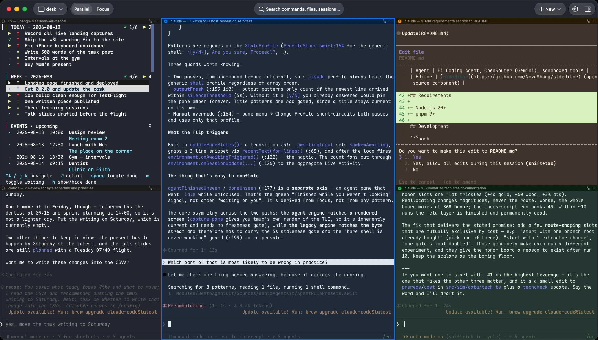

# Bento Term

English | [简体中文](README_CN.md)

[](https://github.com/NovaShang/BentoTerm/releases/latest)
[](LICENSE)

A terminal for running and supervising multiple CLI coding agents at once.
Native macOS, iPhone and iPad clients on top of tmux control mode (`-CC`), with
pane status set through tmux, push-to-talk voice input, and libghostty
rendering.

<p align="center"></p>

Website: [bentoai.dev/term](https://bentoai.dev/term/) · Install: `brew install --cask NovaShang/tap/bento-term` · iPhone/iPad: App Store review in progress

## What it does

- **Attaches to real tmux sessions** via control mode. tmux is bundled for machines that don't have it; if you already run tmux, Bento attaches to your existing server and any other tmux client stays in sync — layouts, panes and scrollback live in tmux, not in the app.
- **Shows each pane's status** — working / awaiting input / done-and-unread — as a color on the pane title bar and in the sidebar. Whatever runs in the pane sets it with one tmux command, `tmux set -p @bento_state working` ([details below](#pane-status), with ready-made hooks for Claude Code and Codex). Nothing reads the screen, so the color doesn't break when a program changes its UI; a pane that doesn't set it just has no color.
- **Two layouts over the same session:** Parallel tiles every pane; Focus gives one pane the window with the rest in a sidebar. Switching rearranges the actual tmux panes rather than maintaining a separate view state.
- **Push-to-talk voice input.** Hold right-click on a pane and speak; the transcript lands in that pane's input. Recognition vocabulary is biased by on-screen text, so identifiers and file names from the visible scrollback transcribe correctly, including mixed Chinese/English. Engines: Apple on-device (default), plus Qwen and OpenAI realtime on your own API key. Speech can also be translated into a shell command.
- **File tree and preview.** Every pane exposes the file tree of its working directory. Printed paths are clickable — resolved even when a TUI wrapped or truncated the line — and open with syntax highlighting and jump-to-line (`path:42`). PDFs, images and other documents open via Quick Look. The same tree works from iOS over the SSH connection.
- **Pane management as tmux operations.** Splits, drag-to-dock between positions and across sessions, duplication — each is executed as a real tmux `split-window` / `move-pane`, so a plain `tmux attach` from elsewhere shows exactly the same layout.
- **iOS/iPadOS client** attaches to the same sessions mid-run over SSH, with the same pane status (it lives in tmux, so every client sees it).

## Architecture

| Layer | Choice |
|---|---|
| Terminal rendering | [libghostty](https://ghostty.org) — every pane is a real GPU-accelerated terminal surface (GhosttyKit xcframework), not a webview or a from-scratch emulator |
| Multiplexing | tmux control mode (`-CC`), with tmux bundled and [`BentoTmuxKit`](Modules/BentoTmuxKit/) as our own strict, heavily-tested protocol client |
| Apps | Native Swift end to end — AppKit/SwiftUI on macOS, UIKit/SwiftUI on iOS — as thin shells over the shared [`Modules/`](Modules/) packages |
| Pane status | A tmux pane option (`@bento_state`) that any program sets on its own pane; the client reads it with its regular `list-panes` poll |
| SSH | macOS rides your system OpenSSH, so `~/.ssh/config`, ControlMaster, and jump hosts all just work; a remote host needs only `sshd` + `tmux` |
| Voice | A `SpeechEngine` abstraction over Apple on-device, OpenAI, and Qwen realtime ASR, with on-screen-context vocabulary biasing |

Two design rules shape everything:

1. **tmux is the source of truth.** The app renders and edits tmux state; it never owns a private copy. That's why sessions outlive the app and why any other tmux client agrees with what Bento shows.
2. **Transport is dumb, clients are smart.** Everything works over a plain local shell or vanilla SSH. Terminal intelligence lives in the client and never moves server-side, and nothing of Bento's is installed on the remote machine. Pane status is the one thing the client doesn't work out: the program in the pane says it, through a tmux pane option, and tmux carries it.

## Install

Requirements: macOS 27+ on Apple Silicon.

```sh
brew install --cask NovaShang/tap/bento-term
```

Or download `BentoTerm-macos-arm64.zip` from the [latest release](https://github.com/NovaShang/BentoTerm/releases/latest) and drag `BentoTerm.app` into `/Applications` — signed and notarized.

The app is self-contained (tmux bundled). A remote machine needs only `sshd` and
`tmux`; reachability (NAT, VPN, Tailscale, jump hosts) is handled by your
`~/.ssh/config` — there is no relay and no host-side component.

## Pane status

A pane's color is what the program running in it says it is doing. Set it from inside the pane:

```sh
tmux set -p @bento_state working    # blue
tmux set -p @bento_state awaiting   # amber: it needs you
tmux set -p @bento_state done       # finished; green if you weren't looking at the pane
tmux set -pu @bento_state           # clear
```

It works for any program: a build, a long test run, a deploy script, a coding agent. It's an ordinary tmux pane option, so it works the same on the Mac and on a remote host, and every tmux client sees it. Bento reads it on its pane poll and never reads the screen to guess, so a pane that doesn't set it has no color. While the pane sits at a bare shell prompt the option is ignored, so a program that exits without clearing it doesn't leave the pane tinted.

### Example: Claude Code and Codex hooks

These hooks set the status from the agent's own events. Set them up on whichever machine runs the agent, the Mac or the remote host. Every command checks `$TMUX_PANE` first, so outside tmux it does nothing.

**Claude Code**, in `~/.claude/settings.json` (merge into an existing `hooks` block if you have one):

```json
{
  "hooks": {
    "SessionStart": [
      {
        "matcher": "startup|resume|clear",
        "hooks": [{ "type": "command", "command": "[ -n \"$TMUX_PANE\" ] && tmux set -p -t \"$TMUX_PANE\" @bento_state done; true" }]
      }
    ],
    "UserPromptSubmit": [
      { "hooks": [{ "type": "command", "command": "[ -n \"$TMUX_PANE\" ] && tmux set -p -t \"$TMUX_PANE\" @bento_state working; true" }] }
    ],
    "PostToolUse": [
      { "hooks": [{ "type": "command", "command": "[ -n \"$TMUX_PANE\" ] && tmux set -p -t \"$TMUX_PANE\" @bento_state working; true" }] }
    ],
    "Notification": [
      {
        "matcher": "permission_prompt",
        "hooks": [{ "type": "command", "command": "[ -n \"$TMUX_PANE\" ] && tmux set -p -t \"$TMUX_PANE\" @bento_state awaiting; true" }]
      }
    ],
    "Stop": [
      { "hooks": [{ "type": "command", "command": "[ -n \"$TMUX_PANE\" ] && tmux set -p -t \"$TMUX_PANE\" @bento_state done; true" }] }
    ],
    "SessionEnd": [
      { "hooks": [{ "type": "command", "command": "[ -n \"$TMUX_PANE\" ] && tmux set -pu -t \"$TMUX_PANE\" @bento_state; true" }] }
    ]
  }
}
```

Claude Code doesn't run a hook when you interrupt a turn with Esc, so the pane stays blue until the next prompt or tool call.

**Codex**, in `~/.codex/hooks.json`. Codex skips hooks it hasn't been told to trust: open `/hooks` in Codex once to review and trust them, and again after you change them.

```json
{
  "hooks": {
    "SessionStart": [
      {
        "matcher": "startup|resume|clear",
        "hooks": [{ "type": "command", "command": "[ -n \"$TMUX_PANE\" ] && tmux set -p -t \"$TMUX_PANE\" @bento_state done; true" }]
      }
    ],
    "UserPromptSubmit": [
      { "hooks": [{ "type": "command", "command": "[ -n \"$TMUX_PANE\" ] && tmux set -p -t \"$TMUX_PANE\" @bento_state working; true" }] }
    ],
    "PostToolUse": [
      { "hooks": [{ "type": "command", "command": "[ -n \"$TMUX_PANE\" ] && tmux set -p -t \"$TMUX_PANE\" @bento_state working; true" }] }
    ],
    "PermissionRequest": [
      { "hooks": [{ "type": "command", "command": "[ -n \"$TMUX_PANE\" ] && tmux set -p -t \"$TMUX_PANE\" @bento_state awaiting; true" }] }
    ],
    "Stop": [
      { "hooks": [{ "type": "command", "command": "[ -n \"$TMUX_PANE\" ] && tmux set -p -t \"$TMUX_PANE\" @bento_state done; echo '{}'" }] }
    ],
    "Interrupt": [
      { "hooks": [{ "type": "command", "command": "[ -n \"$TMUX_PANE\" ] && tmux set -p -t \"$TMUX_PANE\" @bento_state done; true" }] }
    ],
    "SessionEnd": [
      { "hooks": [{ "type": "command", "command": "[ -n \"$TMUX_PANE\" ] && tmux set -pu -t \"$TMUX_PANE\" @bento_state; true" }] }
    ]
  }
}
```

`Stop` prints `{}` because Codex expects JSON from that hook.

These commands run whichever `tmux` comes first on the program's `PATH`, and `$TMUX` points it at the server that pane belongs to. On a Mac without its own tmux, Bento adds its bundled one to every local pane's `PATH`, so `tmux set` finds it there too.

## Privacy

- No accounts.
- Terminal output never leaves your machines; the connection is plain SSH.
- No telemetry.
- Voice audio stays on the device with Apple's engine. With Qwen or OpenAI it goes straight to that provider on your own key; Bento runs no server in between.

## Repository layout

| Directory | What it is |
|---|---|
| `BentoTermMac/` | macOS app — AppKit/SwiftUI shell |
| `BentoTermiOS/` | iOS / iPadOS app — UIKit/SwiftUI shell |
| `Modules/BentoTmuxKit/` | tmux control-mode (`-CC`) protocol client |
| `Modules/BentoGhosttyKit/` | Terminal surfaces over libghostty |
| `Modules/BentoSessionKit/` | Session, window and pane logic, including pane status |
| `Modules/BentoVoiceKit/` | Speech engines and the voice controller |
| `Modules/BentoFilePreviewKit/` | Path resolution and rich file preview |
| `Modules/BentoUISharedKit/` | UI shared across both platforms |
| `Modules/BentoFoundationKit/` | Logging and low-level shared utilities |
| `Modules/GhosttyKit/` | libghostty as a binary xcframework target |
| `docs/` | PRD, design docs, bug tracker |

## Building from source

You need Xcode 26+. GhosttyKit — libghostty packaged as an xcframework — is fetched automatically as a Swift Package binary target. A build-phase script runs `scripts/fetch-bundled-tmux.sh` to pull the prebuilt tmux pinned in `scripts/bundled-tmux.version` and embeds it at `BentoTerm.app/Contents/MacOS/helpers/tmux`; it needs the `gh` CLI, and without it the app falls back to a system tmux.

```sh
git clone https://github.com/NovaShang/BentoTerm.git && cd BentoTerm
xcodebuild -project BentoTerm.xcodeproj -scheme BentoTermMac -configuration Release build
```

The `BentoTermMac` scheme is the macOS app; the `BentoTermiOS` scheme is iOS. If you change `project.yml`, regenerate the project with [XcodeGen](https://github.com/yonaskolb/XcodeGen).

## License

[Apache-2.0](LICENSE)
