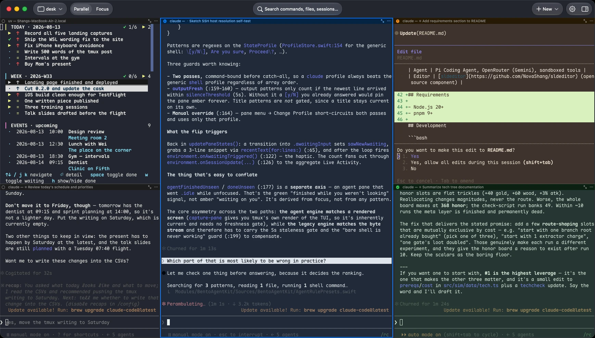

# Bento Term

[English](README.md) | 简体中文

[](https://github.com/NovaShang/BentoTerm/releases/latest)
[](LICENSE)

一个用来同时运行、监督多个 CLI 编程 agent 的终端。macOS、iPhone、iPad 原生
客户端，构建在 tmux 控制模式（`-CC`）之上，pane 状态通过 tmux 设置，带按住
说话的语音输入，渲染用 libghostty。

<p align="center"></p>

官网：[bentoai.dev/term/zh](https://bentoai.dev/term/zh/) · 安装：`brew install --cask NovaShang/tap/bento-term` · iPhone/iPad：App Store 审核中

## 它做什么

- **接管真实 tmux 会话**（控制模式）。tmux 内置打包，没装过也能用；本来就在用 tmux 的话，Bento 直接接上你现有的 server，其他 tmux 客户端全程同步——布局、pane、回滚都在 tmux 里，不在 app 里。
- **显示每个 pane 的状态**：工作中、等你回复、干完了还没看，用颜色标在 pane 标题栏和侧栏上。状态由 pane 里跑的程序自己设，一条 tmux 命令就行：`tmux set -p @bento_state working`（详见[下面](#pane-状态)，附 Claude Code 和 Codex 的现成 hook）。不看屏幕，所以程序改了界面颜色也不会乱；没设的 pane 就不显示颜色。
- **同一会话的两种布局：**Parallel 全部平铺；Focus 一格占满窗口、其余收进侧栏。切换重排的是真实 tmux pane，不维护独立的视图状态。
- **按住说话。**在 pane 上按住右键说话，转写落进该 pane 的输入。识别词表按屏幕上下文加权，可见回滚里的标识符、文件名都能正确转写，中英混说可用。引擎：Apple 端上（默认），以及用你自己 key 的 Qwen、OpenAI 实时识别。也可以把自然语言翻译成 shell 命令。
- **文件树与预览。**每个 pane 暴露其工作目录的文件树。打印出的路径可点——TUI 折行或截断的也能解析——以语法高亮打开并跳转到行（`path:42`）。PDF、图片等走 Quick Look。iOS 上经同一条 SSH 连接使用同一棵树。
- **pane 管理即 tmux 操作。**分屏、跨位置/跨会话拖放、复制，每一步都执行真实的 tmux `split-window` / `move-pane`，从别处 `tmux attach` 看到的布局完全一致。
- **iOS/iPadOS 客户端**经 SSH 随时接上跑到一半的会话，pane 状态也一样（状态存在 tmux 里，哪个客户端看都一样）。

## 架构

| 层 | 选择 |
|---|---|
| 终端渲染 | [libghostty](https://ghostty.org)——每个 pane 都是真实的 GPU 加速终端表面（GhosttyKit xcframework），不是 webview，也不是从零写的模拟器 |
| 复用 | tmux 控制模式（`-CC`），tmux 内置打包，[`BentoTmuxKit`](Modules/BentoTmuxKit/) 是我们自己写的严格、重测试的协议客户端 |
| 应用 | 端到端原生 Swift——macOS 用 AppKit/SwiftUI，iOS 用 UIKit/SwiftUI——都是共享 [`Modules/`](Modules/) 包上的薄壳 |
| Pane 状态 | 一个 tmux pane 选项（`@bento_state`），任何程序都能在自己的 pane 上设，客户端在例行的 `list-panes` 轮询里读出来 |
| SSH | macOS 直接用系统 OpenSSH，`~/.ssh/config`、ControlMaster、跳板机全部照常；远端只需要 `sshd` + `tmux` |
| 语音 | `SpeechEngine` 抽象覆盖 Apple 端上、OpenAI、Qwen 实时 ASR，带屏幕上下文词表加权 |

两条设计铁律贯穿一切：

1. **tmux 是唯一真理源。**app 只渲染和编辑 tmux 的状态，从不自己留一份。所以会话比 app 活得久，其他任何 tmux 客户端看到的都和 Bento 一致。
2. **传输要笨，客户端要聪明。**一切都跑在普通本地 shell 或原味 SSH 上。终端智能都在客户端，不上服务端，远端也不装 Bento 的任何东西。只有 pane 状态不是客户端自己判断的：pane 里的程序通过 tmux pane 选项自己报，tmux 负责传过来。

## 安装

要求：macOS 27+，Apple Silicon。

```sh
brew install --cask NovaShang/tap/bento-term
```

或从 [最新 release](https://github.com/NovaShang/BentoTerm/releases/latest) 下载 `BentoTerm-macos-arm64.zip`，解压把 `BentoTerm.app` 拖进 `/Applications`——已签名公证。

app 自带 tmux。远端机器只需要 `sshd` 和 `tmux`；连通性（NAT、VPN、Tailscale、
跳板机）由你的 `~/.ssh/config` 解决——没有中转服务，也没有主机侧组件。

## Pane 状态

pane 的颜色就是 pane 里跑的程序自己说它在干什么。在 pane 里面设：

```sh
tmux set -p @bento_state working    # 蓝：在干活
tmux set -p @bento_state awaiting   # 琥珀：等你
tmux set -p @bento_state done       # 干完了；你当时没在看这个 pane 就变绿
tmux set -pu @bento_state           # 清掉
```

什么程序都能用：编译、跑很久的测试、部署脚本、编程 agent。这就是个普通的 tmux pane 选项，Mac 本机和远端一个用法，哪个 tmux 客户端都看得到。Bento 轮询 pane 时读它，从不看屏幕去猜，所以没设的 pane 就没有颜色。pane 回到光秃秃的 shell 提示符时这个选项不算数，程序退出时忘了清也不会让 pane 一直带着颜色。

### 例子：Claude Code 和 Codex 的 hook

这些 hook 跟着 agent 自己的事件去设状态。配在跑 agent 的那台机器上，Mac 本机或远端都一样。每条命令都先看 `$TMUX_PANE`，不在 tmux 里就什么都不做。

**Claude Code**，写进 `~/.claude/settings.json`（已经有 `hooks` 的话合并进去）：

```json
{
  "hooks": {
    "SessionStart": [
      {
        "matcher": "startup|resume|clear",
        "hooks": [{ "type": "command", "command": "[ -n \"$TMUX_PANE\" ] && tmux set -p -t \"$TMUX_PANE\" @bento_state done; true" }]
      }
    ],
    "UserPromptSubmit": [
      { "hooks": [{ "type": "command", "command": "[ -n \"$TMUX_PANE\" ] && tmux set -p -t \"$TMUX_PANE\" @bento_state working; true" }] }
    ],
    "PostToolUse": [
      { "hooks": [{ "type": "command", "command": "[ -n \"$TMUX_PANE\" ] && tmux set -p -t \"$TMUX_PANE\" @bento_state working; true" }] }
    ],
    "Notification": [
      {
        "matcher": "permission_prompt",
        "hooks": [{ "type": "command", "command": "[ -n \"$TMUX_PANE\" ] && tmux set -p -t \"$TMUX_PANE\" @bento_state awaiting; true" }]
      }
    ],
    "Stop": [
      { "hooks": [{ "type": "command", "command": "[ -n \"$TMUX_PANE\" ] && tmux set -p -t \"$TMUX_PANE\" @bento_state done; true" }] }
    ],
    "SessionEnd": [
      { "hooks": [{ "type": "command", "command": "[ -n \"$TMUX_PANE\" ] && tmux set -pu -t \"$TMUX_PANE\" @bento_state; true" }] }
    ]
  }
}
```

按 Esc 打断一轮时 Claude Code 不会跑任何 hook，所以 pane 会一直是蓝的，直到下一次提问或调用工具。

**Codex**，写进 `~/.codex/hooks.json`。Codex 不跑没被信任过的 hook：在 Codex 里打开一次 `/hooks`，过一遍、选信任，以后改了要再信任一次。

```json
{
  "hooks": {
    "SessionStart": [
      {
        "matcher": "startup|resume|clear",
        "hooks": [{ "type": "command", "command": "[ -n \"$TMUX_PANE\" ] && tmux set -p -t \"$TMUX_PANE\" @bento_state done; true" }]
      }
    ],
    "UserPromptSubmit": [
      { "hooks": [{ "type": "command", "command": "[ -n \"$TMUX_PANE\" ] && tmux set -p -t \"$TMUX_PANE\" @bento_state working; true" }] }
    ],
    "PostToolUse": [
      { "hooks": [{ "type": "command", "command": "[ -n \"$TMUX_PANE\" ] && tmux set -p -t \"$TMUX_PANE\" @bento_state working; true" }] }
    ],
    "PermissionRequest": [
      { "hooks": [{ "type": "command", "command": "[ -n \"$TMUX_PANE\" ] && tmux set -p -t \"$TMUX_PANE\" @bento_state awaiting; true" }] }
    ],
    "Stop": [
      { "hooks": [{ "type": "command", "command": "[ -n \"$TMUX_PANE\" ] && tmux set -p -t \"$TMUX_PANE\" @bento_state done; echo '{}'" }] }
    ],
    "Interrupt": [
      { "hooks": [{ "type": "command", "command": "[ -n \"$TMUX_PANE\" ] && tmux set -p -t \"$TMUX_PANE\" @bento_state done; true" }] }
    ],
    "SessionEnd": [
      { "hooks": [{ "type": "command", "command": "[ -n \"$TMUX_PANE\" ] && tmux set -pu -t \"$TMUX_PANE\" @bento_state; true" }] }
    ]
  }
}
```

`Stop` 那条会输出 `{}`，因为 Codex 要求这个 hook 返回 JSON。

这些命令用的是程序 `PATH` 里排第一的 `tmux`，`$TMUX` 会把它指到这个 pane 所在的 server。Mac 上没装 tmux 也没关系，Bento 会把自带的 tmux 加进每个本地 pane 的 `PATH`，`tmux set` 一样找得到。

## 隐私

- 没有账号。
- 终端输出不离开你的机器；连接是纯 SSH。
- 没有遥测。
- 用 Apple 引擎时音频不出设备。用 Qwen 或 OpenAI 时，音频用你自己的 key 直接发给对方，中间没有 Bento 的服务器。

## 仓库结构

| 目录 | 是什么 |
|---|---|
| `BentoTermMac/` | macOS app——AppKit/SwiftUI 壳 |
| `BentoTermiOS/` | iOS / iPadOS app——UIKit/SwiftUI 壳 |
| `Modules/BentoTmuxKit/` | tmux 控制模式（`-CC`）协议客户端 |
| `Modules/BentoGhosttyKit/` | libghostty 之上的终端表面 |
| `Modules/BentoSessionKit/` | 会话、窗口、pane 逻辑，含 pane 状态 |
| `Modules/BentoVoiceKit/` | 语音引擎与语音控制器 |
| `Modules/BentoFilePreviewKit/` | 路径解析与富文件预览 |
| `Modules/BentoUISharedKit/` | 双平台共享 UI |
| `Modules/BentoFoundationKit/` | 日志与底层共享工具 |
| `Modules/GhosttyKit/` | libghostty 二进制 xcframework target |
| `docs/` | PRD、设计文档、bug 台账 |

## 从源码构建

需要 Xcode 26+。GhosttyKit——打包成 xcframework 的 libghostty——作为 Swift Package binary target 自动拉取。构建阶段脚本 `scripts/fetch-bundled-tmux.sh` 会按 `scripts/bundled-tmux.version` 钉住的版本拉预编译 tmux 并嵌入 `BentoTerm.app/Contents/MacOS/helpers/tmux`；它需要 `gh` CLI，没有的话 app 回退到系统 tmux。

```sh
git clone https://github.com/NovaShang/BentoTerm.git && cd BentoTerm
xcodebuild -project BentoTerm.xcodeproj -scheme BentoTermMac -configuration Release build
```

`BentoTermMac` scheme 是 macOS app；`BentoTermiOS` scheme 是 iOS。改了 `project.yml` 要用 [XcodeGen](https://github.com/yonaskolb/XcodeGen) 重新生成工程。

## 许可

[Apache-2.0](LICENSE)
